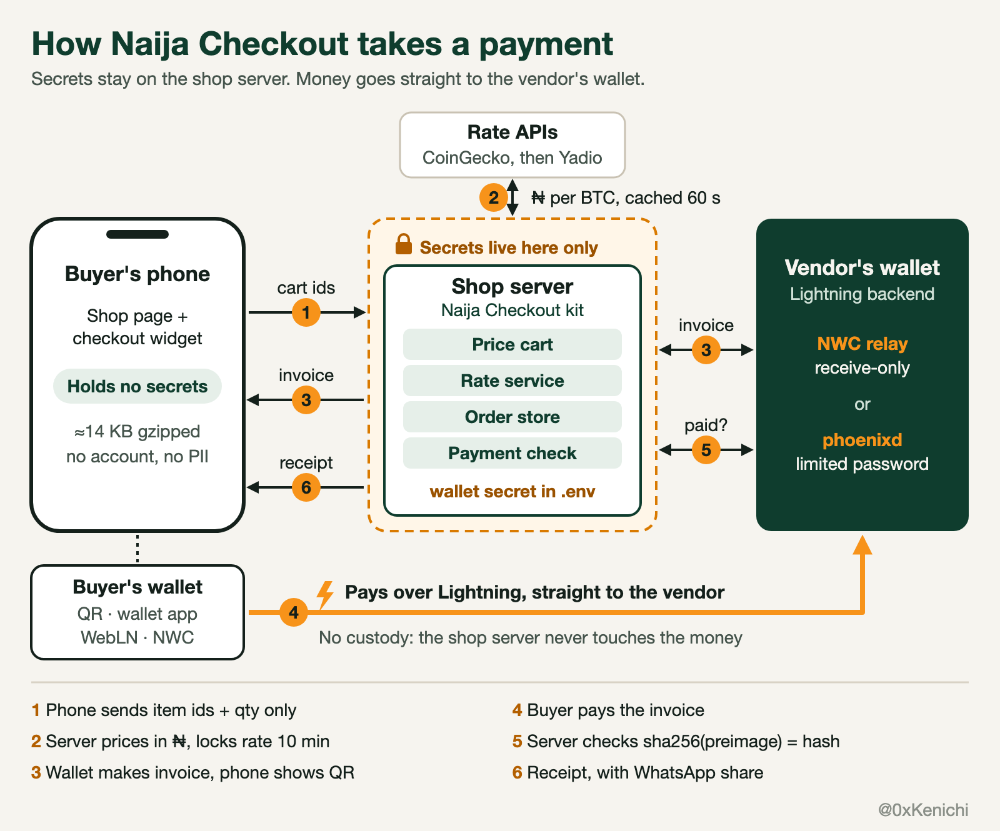

# Module 4: Naija Checkout, a Lightning checkout for your client's site

Most Nigerian small businesses sell on Instagram and WhatsApp, and many of them pay a freelance developer to build a simple site. This module gives that developer a drop-in Lightning checkout they can add in an afternoon:

- **Prices stay in naira.** The buyer sees ₦9,000, not 0.00010621 BTC. The kit converts at today's rate and locks it for 10 minutes.
- **The buyer pays from any Lightning wallet:** scan a QR code, tap "Open wallet app", use a browser wallet (WebLN), or connect a wallet with Nostr Wallet Connect (module 5).
- **The shop never holds anyone's money.** Payments go straight into the vendor's own wallet. The kit can create invoices and check them, and that's all it can do.
- **A receipt at the end** that the buyer can send on WhatsApp, with a payment proof anyone can check.

You'll run it first in a demo shop, **Yaba Thrift Corner**, a made-up thrift vendor that uses free test sats. Nothing in it costs money.



**You need:** Node.js 20 or newer, a terminal and about two hours. Module 1 helps but isn't required.

## Try it live first

[0xkenichi.github.io/naija-checkout](https://0xkenichi.github.io/naija-checkout/) is the same shop as a static page. A free static host can't run a server, so in that version the checkout's server part runs inside the page against two throwaway test wallets made for your visit. On a real site it runs on your server, as below. ([`src/browser/hosted.ts`](code/src/browser/hosted.ts) shows the difference.)

## Run the demo (one command)

```bash
cd 04-lightning-checkout/code
npm install
npm run demo          # opens the shop on http://localhost:8787
```

The first run makes two free test wallets on the [NWC Faucet](https://faucet.nwc.dev), one for the shop and one for a pretend customer with 100,000 test sats, and writes them to `.env`. The faucet says it plainly: "Balances are not real and exist only inside the NWC Faucet."

Open the shop on your phone or in a narrow browser window. Add a couple of items, press **Pay with ⚡ Lightning**, then press **Demo: pay from test buyer wallet**. That button stands in for the customer's phone. A few seconds later you get the receipt.

> **Don't pay the demo's invoices from a real wallet.** They're real-format Lightning invoices on a test service. Use the demo button, the test buyer wallet, or `npm run pay -- <invoice>`.

Two more checks:
```bash
npm run selftest      # 16 offline tests: pricing, rates, expiry, fake-payment detection, HTTP limits
npm run e2e           # live: create an order, pay it over NWC, wait for "paid", verify the proof
```
NWC talks through public Nostr relays. If a step times out once, run it again.

## Four ideas before you read the code

**1. An invoice is a one-time payment request.** A Lightning invoice (it starts with `lnbc`) says "pay exactly 10,621 sats to this wallet within 10 minutes". It can be paid once. Your server makes a new one for every order.

**2. The server decides the price, never the browser.** Anyone can edit the JavaScript in their browser and change ₦9,000 to ₦9. So the browser sends only item ids and quantities. The server looks up prices, does the maths and creates the invoice.

**3. The server decides "paid", never the browser.** The same trick works on the success screen. Your server asks the vendor's wallet whether the invoice was paid, and only then marks the order paid.

**4. The preimage is the receipt.** Every invoice has a *payment hash*. When it's paid, the payer's wallet learns a secret 32-byte *preimage* whose SHA-256 equals that hash. Nobody but the payer (and the receiving wallet) learns it, and only once the payment completes. The kit checks it twice: the server checks the preimage the vendor's wallet reports, and when the buyer pays from the page (NWC or WebLN), the buyer's phone checks the preimage **its own wallet** got back against the hash it decodes from the invoice ("✓ Payment proof verified on this phone"). The second check is the one that protects the buyer, because it doesn't trust the shop at all.

## How the kit fits together

| File | What it does |
|---|---|
| `src/kit/checkout.ts` | Prices the cart from your catalog, locks the rate, creates the invoice, tracks the order: `pending` → `paid` or `expired` |
| `src/kit/bolt11.ts` | Reads the payment hash out of a Lightning invoice (bech32, checksum checked) in about 40 lines, no library |
| `src/kit/rates.ts` | Naira rate from CoinGecko, then Yadio. 60-second cache, sanity bounds, refuses a jump of more than 25%, falls back to the last good rate and labels it "may be out of date" |
| `src/kit/backends/nwc.ts` | Vendor's wallet over Nostr Wallet Connect (Alby Hub, Coinos, LNbits and others). Refuses connections that can spend |
| `src/kit/backends/phoenixd.ts` | Vendor's own [phoenixd](https://phoenix.acinq.co/server) node over its HTTP API |
| `src/kit/backends/fake.ts` | No network. For tests and for learning |
| `src/kit/http.ts` | Two routes for any Node server: `POST /api/orders`, `GET /api/orders/:id` |
| `src/browser/checkout.ts` | The payment sheet: naira total, QR, wallet buttons, countdown, receipt. No framework |
| `src/demo/` | The Yaba Thrift Corner demo shop |
| `src/browser/hosted.ts` | The static live-demo version (checkout runs in the page, test wallets only) |

### Add it to a client's site

On the server (any Node app):
```ts
import { Checkout, OrderStore, RateService, backendFromEnv, checkoutRoutes } from "./kit/index.ts";

const checkout = new Checkout({
  backend: backendFromEnv(),               // reads MERCHANT_NWC_URL from .env
  rates: new RateService({ fallback: { nairaPerBtc: 85_000_000, asOf: "19 Nov 2026" } }),
  catalog,                                 // [{ id, name, priceNaira, ... }]
  store: new OrderStore("data/orders.json"),
  shopName: "Mama Tee's Kitchen",
});
const routes = checkoutRoutes(checkout, catalog);
// in your request handler:  if (await routes(req, res)) return;
```

In the page:
```html
<link rel="stylesheet" href="/naija-checkout.css">   <!-- override --nc-accent etc. for the client's brand -->
<script type="module" src="/dist/naija-checkout.js"></script>
<script type="module">
  payButton.onclick = () => NaijaCheckout.open({ cart: [{ id: "jollof-tray", qty: 1 }], shopName: "Mama Tee's Kitchen" });
</script>
```

### Going live with a real vendor
1. The vendor installs a Lightning wallet that supports NWC (for example Alby Hub or Coinos) and creates a connection with **only** "create invoices" and "look up invoices". The kit refuses a connection that can send money.
2. Put that connection string in `.env` on the server as `MERCHANT_NWC_URL`. Delete `ALLOW_SPEND_PERMISSIONS`, `DEMO_MODE` and `BUYER_TEST_NWC_URL`.
3. Serve the site over HTTPS. Keep the security headers from `src/demo/server.ts`.
4. Test with a ₦200 item before you announce it.

## Built for Nigerian phones and data
- **The shop page is about 15 KB gzipped** (HTML, CSS and JavaScript, measured by `npm run build`). The static live demo is bigger (about 52 KB) because the server part and the NWC library ride along in the page. No web fonts, no images, no framework. The NWC code (38 KB) only downloads if the buyer chooses NWC.
- **"Open wallet app" first.** On a phone you can't scan a QR code on your own screen, so the main button opens the wallet directly.
- **Bad network handling.** Status checks back off when the network fails, slow down when the tab is hidden, and say "You're offline" instead of spinning forever. The server asks the wallet at most once every 2 seconds per order, however many tabs are polling.
- **48 px touch targets**, readable at 360 px wide, and the payment sheet slides up from the bottom like the apps buyers already use.

## Security
Read [SECURITY.md](SECURITY.md) for the full threat model. In short: no custody, receive-only wallet permissions, secrets only on the server, server-side prices and payment checks, preimage verification, strict Content Security Policy, request limits, and no personal data collected or logged.

## Constraints (what this module doesn't do yet)
- **No automatic refunds.** Lightning has no "reverse payment". To refund, the vendor asks the buyer for an invoice and pays it from their wallet. Module 6 covers payment states and refunds properly.
- **One order store file.** Fine for one small shop. Use a real database for anything bigger.
- **The phoenixd backend** is written against phoenixd's documented API and tested against a mock server, not yet against a live node.
- **Rates differ between sources.** CoinGecko and Yadio can be a few percent apart. The receipt always shows which rate and source were used.
- **The demo button** (`DEMO_MODE=1`) is for test wallets only and is off by default.

## Exercises
1. Add a "delivery area" option (Mainland/Island) with a delivery fee, priced on the server.
2. Change the price lock from 10 minutes to 5. What breaks for a buyer on a slow network?
3. Make `RateService` use the median of three sources instead of the first that answers.
4. Write a test that proves a cart can't be paid twice.

**Next:** [Module 5: paying from the buyer's own wallet](../05-pay-from-wallets/) (WebLN and Nostr Wallet Connect).
