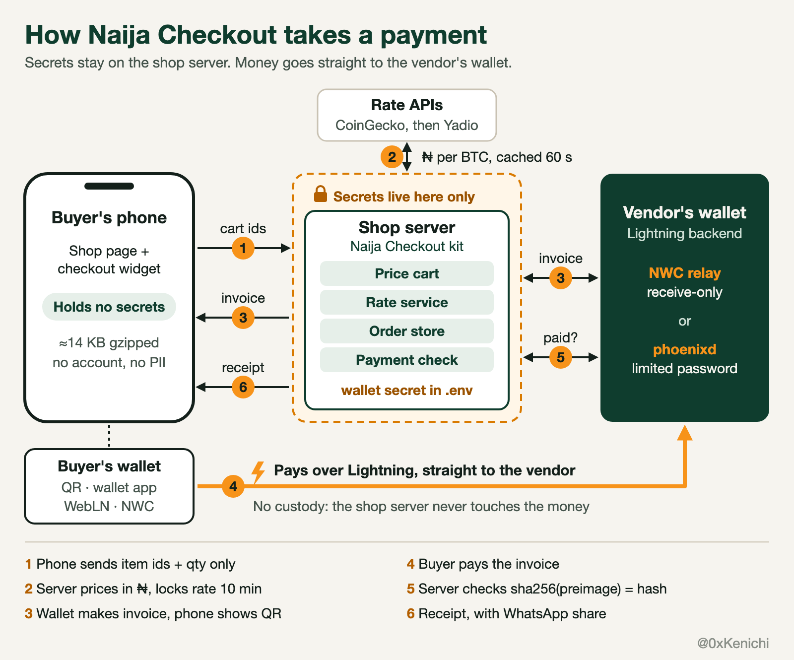

# Build on Bitcoin, Naija

A free, open course for Nigerian web developers: add Bitcoin and Lightning payments to real apps. Each module has a written guide and working code you can run without spending real money. Short videos follow.

## New: Naija Checkout (modules 4–5)

**A drop-in Lightning checkout a Lagos web developer can add to a client's site in an afternoon.** Prices stay in naira, the buyer pays from any Lightning wallet, the vendor's money never passes through the developer, and the buyer gets a receipt they can send on WhatsApp.

**Try it now on your phone:** [0xkenichi.github.io/naija-checkout](https://0xkenichi.github.io/naija-checkout/) (test sats only, about a minute end to end). **Watch the 2½-minute demo:** [youtu.be/ay3Vm6uqH8Y](https://youtu.be/ay3Vm6uqH8Y).

Or run it yourself:
```bash
cd 04-lightning-checkout/code
npm install
npm run demo        # demo shop on http://localhost:8787, free test wallets made for you
npm run selftest    # 16 offline tests
npm run e2e         # live paid order over Nostr Wallet Connect (with the demo running)
```



| | |
|---|---|
| **Who it's for** | Nigerian freelance web developers who build sites for small vendors (Instagram and WhatsApp sellers, food vendors, thrift shops). The vendors and their buyers benefit next. |
| **What changes for them** | Today a vendor's site often ends at "send proof of transfer to this WhatsApp number", and someone checks bank alerts by hand. With the kit, the site shows a naira price, takes a Lightning payment straight into the vendor's own wallet, and confirms it automatically with a receipt. |
| **Guide** | [Module 4: the checkout](04-lightning-checkout/) · [Module 5: paying from the buyer's own wallet](05-pay-from-wallets/) · [Threat model](04-lightning-checkout/SECURITY.md) |
| **Built for** | Mid-range Android phones on slow data: the shop page is about 15 KB gzipped, no web fonts or framework, and wallet code loads only when needed |
| **Security** | No custody, receive-only wallet permissions, secrets only on the server, server-side prices and payment checks, preimage verification, strict CSP, request limits, no personal data |

### Constraints
Few Nigerian buyers pay with Lightning today, so for now this is an extra way to pay next to bank transfer, not a replacement. The vendor holds sats in their own wallet; turning them into naira is up to the vendor (an exchange or peer-to-peer trade of their choice), and the kit doesn't touch that step. Refunds are manual for now (module 6). The phoenixd backend is tested against a mock, not a live node yet. NWC depends on public Nostr relays unless the vendor runs their own. This is teaching code and hasn't been audited.

### Reach (estimate, not a result)
The two planned Lagos workshops at about 30 developers each reach 60 developers. If a third of them ship the checkout for two client vendors each, that's about 40 live shops in the first six months, before counting developers who learn from GitHub alone. Each developer is a multiplier: they build for many vendors.

### What we'll measure
These are the numbers we'll track from here on, not results we have yet:
- developers who run `npm run demo` and finish the module 4 exercises (exercise pull requests and issues);
- vendor shops that go live with the kit (developers report them through a GitHub issue);
- time from `git clone` to the first paid test order (goal: under 15 minutes);
- shop page weight (budget: under 20 KB gzipped).

### Next iteration
1. Module 6: payment states, refunds and a pre-mainnet checklist.
2. Videos for modules 4–5 with Pidgin subtitles, after a native speaker reviews the script.
3. A Lightning address / LNURL payment option, and a WordPress/WooCommerce wrapper, since many client sites run on WordPress.
4. The Lagos workshops (below), where developers leave with the checkout running in their own client's site.

## Modules
1. **Bitcoin for web developers:** keys, addresses and transactions on signet with bitcoinjs-lib. *(live)*
2. **Reading the chain:** watch for payments and confirmations with mempool.space's open-source API.
3. **Accepting payments:** a self-hosted BTCPay Server in a web app.
4. **Lightning checkout:** naira-priced invoices, QR and wallet links, payment checks and receipts, over Nostr Wallet Connect or phoenixd. *(live)*
5. **Paying from users' own wallets:** WebLN and Nostr Wallet Connect. *(live)*
6. **Shipping safely:** payment states and refunds, testing before mainnet, and never holding users' money.

Each module lives in its own folder (`01-…` to `06-…`) with `README.md` (the guide), `code/` (TypeScript you can run) and `video.md` (outline, then link and Pidgin subtitles).

## Workshops
Two hands-on build sessions in Lagos are planned, one at the University of Lagos. You leave with a working payment flow in your own app.

## Status
- **Module 1:** guide, working code and an offline self-test in [`01-bitcoin-for-web-devs`](01-bitcoin-for-web-devs/). Video next.
- **Modules 4–5:** guide, the Naija Checkout kit, a demo shop, 16 offline tests and a live end-to-end test, built for the Dakar Bitcoin Hack 2026.
- **Modules 2, 3 and 6** follow, with progress posted here every month.

## Run module 1
```bash
cd 01-bitcoin-for-web-devs/code
npm install
npm run selftest
```

## License
- **Code:** MIT
- **Lessons, guides and videos:** [CC BY 4.0](https://creativecommons.org/licenses/by/4.0/)

## Contact
Kenichi · X [@0xKenichi](https://x.com/0xKenichi) · [0xkenichi.github.io](https://0xkenichi.github.io)
